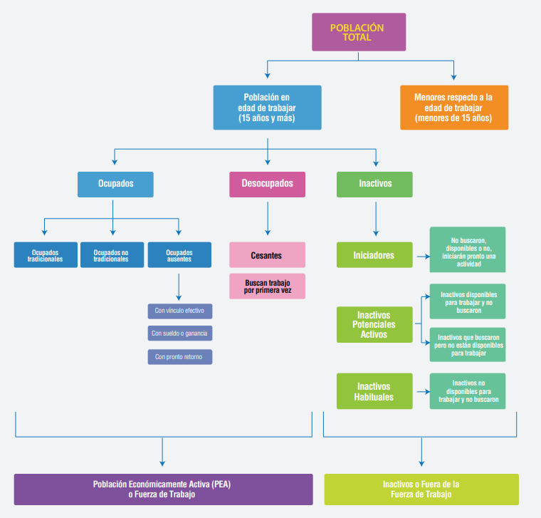
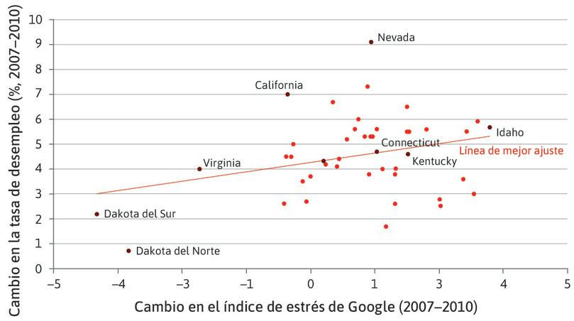
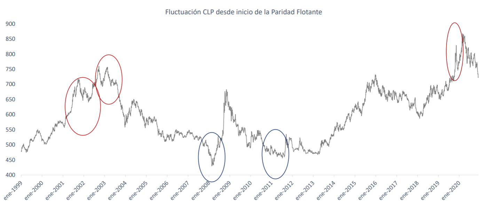
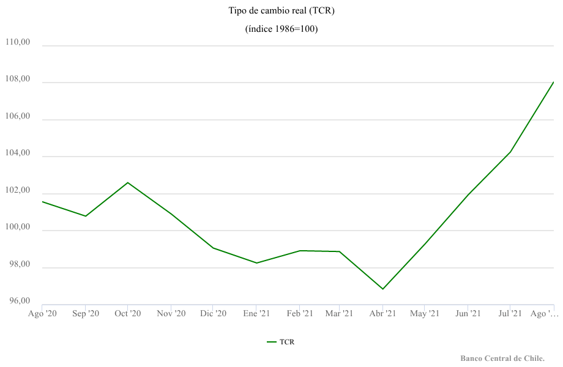

# Presentación del curso

## Equipo docente

**Docentes:**

- Sebastián Egaña Santibáñez

**Ayudante:**

- Jean Pierre Bravo

------------------------------------------------------------------------

## Contenidos del curso

- Análisis de principales variables macroeconómicas
- Políticas macroeconómicas
- Revisión de modelos de mercado de bienes y de activos financieros
- Comportamiento de los agentes económicos: consumo y gobierno

------------------------------------------------------------------------

## Sobre el docente

**Sebastián Egaña Santibáñez**

- Data Tech Lead & Data Scientist — LATAM Airlines
- Correo: [segana@fen.uchile.cl](mailto:segana@fen.uchile.cl)
- Web: <https://segana.netlify.app>
- LinkedIn: [enlace](https://www.linkedin.com/in/sebastian-egana-santibanez/)

------------------------------------------------------------------------

## Hilo conductor de la clase

Partimos con un titular (actividad `clase01_actividad_01_apertura`). Al terminar la sesión deberían poder leerlo con precisión.

::: {style="font-size: 1.15em; font-weight: bold; color: #0d6e6e; border-left: 6px solid #0d6e6e; padding-left: 1em; margin: 1em 0;"}
"US inflation tripled last month on record spike in gas prices"
:::

::: {style="font-size: 0.8em; color: #666;"}
— CNN Business, 10 de abril de 2026
:::

Para entenderlo necesitamos saber qué mide el IPC, cómo se construye, qué tan grave es un alza mensual de 0,9%, y cómo conecta con el empleo, el crecimiento y el tipo de cambio.

------------------------------------------------------------------------

## ¿Qué veremos esta clase?

| Bloque | Conceptos clave |
|---|---|
| Entorno económico | Variables que afectan decisiones |
| Nivel de actividad | PIB, Imacec, bienestar |
| Mercado laboral | Clasificación, tasas, Okun |
| Variables nominales y reales | IPC, deflactor, salario real, tipo de cambio |
| Estabilidad financiera | Sistema financiero, endeudamiento de hogares, empresas y gobierno (IEF, 2026) |

# Entorno Económico

## ¿Por qué importa el entorno? {.smaller}

El entorno económico es el conjunto de variables económicas y financieras que influyen en la toma de decisiones de personas, empresas y gobiernos.

- El **crecimiento económico** se relaciona con el desempeño de los mercados
- La **inflación** erosiona el poder adquisitivo y encarece los costos de las empresas
- El **tipo de cambio** afecta directamente a importadores y exportadores
- La **tasa de interés** determina el costo del financiamiento

> No se puede tomar una decisión de inversión sin leer el entorno. Los indicadores macroeconómicos son el lenguaje en que ese entorno habla.

------------------------------------------------------------------------

## Chile en 2026: punto de partida

::: {.smaller}
| Indicador | Dato | Fuente |
|---|---|---|
| Crecimiento PIB 2025 | **+2,5%** real | IPoM, BCCh, sep. 2026, Tabla 3 |
| Proyección PIB 2026 | **0,25 – 0,75%** (en junio: 1,0 – 1,75%) | IPoM, BCCh, sep. 2026, p. 6 |
| Inflación (últimos meses) | **~4%** anual | IPoM, BCCh, sep. 2026, p. 15 |
| Inflación proyectada (dic. 2026) | **4,3%** | IPoM, BCCh, sep. 2026, Tabla 1 |
| Tasa de desocupación | **9,5%** (9,3% desestacionalizada) | IPoM, BCCh, sep. 2026, p. 5 |
| Precio del cobre | US$6,1/lb proyectado para 2026 | IPoM, BCCh, sep. 2026, Tabla 2 |
| Precio del petróleo | ~US$90/barril al cierre del informe | IPoM, BCCh, sep. 2026, p. 10 |
:::

El shock dominante de 2026 es la **guerra en Medio Oriente** (inicio: 28 feb.), que presiona la energía y la inflación, mientras la **demanda interna se desacelera** y el empleo se deteriora.

# Nivel de Actividad

## ¿Qué mide el nivel de actividad? {.smaller}

Cuando hablamos de nivel de actividad, preguntamos por la producción de una economía. Las métricas principales son:

- **PIB** (Producto Interno Bruto): valor de la producción **final** de bienes y servicios **dentro del territorio** en un período
- **PNB** (Producto Nacional Bruto): producción generada con factores (trabajo y capital) **de propiedad de nacionales**, estén donde estén

El ajuste refleja la diferencia entre dónde se produce y quién lo produce:

$$PNB = PIB + \text{ingreso neto de factores del exterior}$$

donde el ingreso neto de factores es lo que los nacionales **reciben** del exterior menos lo que se **paga** a factores extranjeros.

------------------------------------------------------------------------

## Tres palabras clave del PIB

**Producción:** solo bienes y servicios nuevos — no transferencias, no activos financieros.

**Final:** no se cuentan los bienes intermedios para evitar la doble contabilidad.

**Fronteras:** el PIB captura lo que pasa dentro del país, independiente de la nacionalidad del productor.

> Actividad: ¿Cuenta o no cuenta en el PIB?
> Ver `clase01_actividad_02_pib`

------------------------------------------------------------------------

## 3 formas de medición {.smaller}

Tres ventanas al mismo fenómeno: deben dar el mismo resultado.

| Enfoque | Pregunta | Fórmula |
|---|---|---|
| **Gasto** | ¿Quién compra? | $PIB = C + I + G + (X - M)$ |
| **Producción** (Imacec) | ¿Cuánto se creó? | $PIB = \sum VAB + \text{imp. netos}$ |
| **Ingresos** | ¿Quién lo recibe? | $PIB = \text{remun.} + EBE + \text{ing. mixto} + \text{imp. netos}$ |

- **Valor agregado (VAB):** lo que vende una empresa menos lo que compra a otras. *Panadería:* pan \$250 − harina \$160 = **\$90**. No es utilidad: de ahí paga \$70 en sueldos.
- **Excedente bruto (EBE):** lo que queda del VAB tras pagar remuneraciones: el ingreso del capital. *Panadería:* \$90 − \$70 = **\$20**. Es "bruto" porque no descuenta el desgaste de los activos (ej. el horno).
- **Ingreso mixto:** negocios donde el dueño trabaja en lo suyo. *Almacén:* \$1.000 − mercadería \$700 = \$300, que mezclan su trabajo y su ganancia.
- **Impuestos netos:** impuestos a los productos (ej. IVA) menos subvenciones. Si el Estado cobra \$50 por el pan de \$250, los hogares pagan \$300: el PIB a precios de mercado suma esos \$50 al VAB.

------------------------------------------------------------------------

## Un ejemplo: el pan de \$250 {.smaller}

| Etapa | Vende por | Insumos | Valor agregado | Remuneraciones | Excedente |
|---|---:|---:|---:|---:|---:|
| Agricultor (trigo) | \$100 | \$0 | \$100 | \$60 | \$40 |
| Molino (harina) | \$160 | \$100 | \$60 | \$40 | \$20 |
| Panadería (pan) | \$250 | \$160 | \$90 | \$70 | \$20 |
| **Total** | | | **\$250** | **\$170** | **\$80** |

- **Gasto:** los hogares compran el pan final → \$250
- **Producción:** \$100 + \$60 + \$90 de valor agregado → \$250
- **Ingresos:** \$170 de remuneraciones + \$80 de excedente → \$250

> Es una **identidad contable**, no una causa: que $PIB = C + I + G + X - M$ no implica que subir un componente suba el PIB en la misma cantidad.

------------------------------------------------------------------------

## El Imacec: actividad en tiempo real

El PIB se publica trimestralmente y con desfase. Para tener información más reciente, el Banco Central de Chile publica el **Imacec** (Índice Mensual de Actividad Económica) con ~30 días de retraso.

Se calcula por el **método de valor agregado** y sirve como termómetro mensual de la economía.

En 2025, el PIB creció **2,5% real** — coherente con lo que el Imacec fue mostrando mes a mes.

> Fuente: [Banco Central de Chile — Imacec](https://www.bcentral.cl/web/banco-central/areas/estadisticas/imacec)

------------------------------------------------------------------------

## PIB y bienestar

El PIB per cápita aproxima la relación entre la productividad del país y la situación de su población:

$$\text{PIB per cápita} = \frac{PIB}{\text{Población}}$$

**Sus limitaciones son conocidas:**

- No captura el trabajo doméstico ni la economía informal
- No distingue el valor de mercado del valor social (externalidades)
- No captura la **distribución** del ingreso

> El PIB puede crecer y la mayoría de la población puede no sentirlo.

------------------------------------------------------------------------

## Más allá del PIB

Indicadores complementarios:

- **Índice de Gini:** mide la desigualdad en la distribución del ingreso
- **IDH (PNUD):** combina ingreso, educación y esperanza de vida
- **Índice de Bienestar de la OCDE:** considera trabajo, salud, vivienda, comunidad
- **PIB Verde:** ajustado por degradación ambiental

> ¿Qué indicador usarían para saber si un país "va bien"?

# Mercado Laboral

## Relación con la actividad

Un país con mayor actividad tiende a generar más empleo y mejores salarios. La otra cara es el **desempleo**.

**Definición:** Mercado donde interactúan empleador y empleado, coordinando sus incentivos a través de un salario determinado por el mercado.

> ¿Quién es el oferente y quién es el demandante en el mercado laboral?

------------------------------------------------------------------------

## Interacciones dentro de la empresa

| Departamento | La empresa sabe | Determina |
|---|---|---|
| Recursos Humanos | Precios, salarios y empleabilidad externa | Salario nominal, W |
| Marketing | Lo anterior y demanda de sus productos | Precio de venta, P |
| Producción | Lo anterior, productividad y ventas posibles | Empleo, n |

------------------------------------------------------------------------

## Clasificación de la población

{fig-align="center" width="70%"}

::: {style="font-size: 0.7em; color: #666;"}
En el diagrama: *inactivos* = fuera de la fuerza de trabajo; *PEA* = fuerza de trabajo (denominaciones en desuso según INE, *Glosario ENE*, act. 26 sep. 2025).
:::

------------------------------------------------------------------------

## Definiciones clave (INE) {.smaller}

Se clasifica a la población en edad de trabajar (15 años o más) según lo que hizo en la **semana de referencia** (de lunes a domingo, la semana anterior a la entrevista):

- **Ocupados:** dedicaron al menos 1 hora a producir bienes o servicios a cambio de remuneración o beneficio (en dinero o en especie). Incluye a los **ocupados ausentes**: ausencia temporal, pero con vínculo con su empleo
- **Desocupados:** no ocupados, buscaron trabajo activamente en las últimas 4 semanas (incluida la de referencia) y están disponibles para comenzar en las próximas 2
- **Fuera de la fuerza de trabajo** (antes "inactivos"): ni ocupados ni desocupados

> Quien quiere trabajar pero no busca, o no está disponible (como el trabajador desalentado), queda **fuera** de la tasa de desocupación. El INE lo mide aparte, en los indicadores de subutilización (SU3).

::: {style="font-size: 0.8em; color: #666;"}
Fuente: INE, *Glosario Encuesta Nacional de Empleo* (act. 26 sep. 2025).
:::

------------------------------------------------------------------------

## Criterios de clasificación {.smaller}

**Ocupados** — criterios simultáneos:

| Criterio | Período de referencia |
|---|---|
| Producir un bien o servicio | Semana de referencia |
| Al menos 1 hora de actividad | Semana de referencia |
| Recibir remuneración o beneficio | El pago puede ser posterior |

**Desocupados** — criterios simultáneos:

| Criterio | Período de referencia |
|---|---|
| No haber trabajado al menos 1 hora | Semana de referencia |
| Búsqueda activa de trabajo | Últimas 4 semanas (incluida la de referencia) |
| Disponibilidad para comenzar a trabajar | Próximas 2 semanas |

::: {style="font-size: 0.8em; color: #666;"}
Fuente: INE, *Glosario Encuesta Nacional de Empleo* (act. 26 sep. 2025).
:::

------------------------------------------------------------------------

## Indicadores del mercado laboral {.smaller}

**Tasa de participación (TP)**, **tasa de ocupación (TO)** y **tasa de desocupación (TD)**:

$$TP = \frac{FT}{PET} \qquad TO = \frac{O}{PET} \qquad TD = \frac{DO}{FT} = \frac{FT - O}{FT}$$

PET = población en edad de trabajar; FT = fuerza de trabajo (ocupados + desocupados); O = ocupados; DO = desocupados.

> La TD se calcula sobre la **FT**, no sobre la PET: no es el complemento de la TO.

::: {style="font-size: 0.8em; color: #666;"}
Fuente: INE, *Glosario Encuesta Nacional de Empleo* (act. 26 sep. 2025).
:::

------------------------------------------------------------------------

## Desempleo en sentido amplio: subutilización {.smaller}

La TD es la medida oficial y más estricta. El INE publica otras que suman a quienes no tienen trabajo suficiente:

| Indicador | Numerador | Base |
|---|---|---|
| **TD** | DO | FT |
| **SU1** (comparación internacional) | DO + ID | FT + ID |
| **SU2** | DO + ID + TPI | FT + ID |
| **SU3** | DO + ID + FTP | FTA |
| **SU4** (global) | DO + ID + TPI + FTP | FTA |

- **ID** (iniciadores disponibles): no buscaron porque empezarán pronto un trabajo
- **TPI** (tiempo parcial involuntario): ocupados con 30 horas o menos que quieren más
- **FTP** (fuerza de trabajo potencial): quieren trabajar pero no buscan o no están disponibles (ej. desalentados)
- **FTA** (fuerza de trabajo ampliada) = FT + ID + FTP

::: {style="font-size: 0.8em; color: #666;"}
Fuente: INE, *Glosario Encuesta Nacional de Empleo* (act. 26 sep. 2025).
:::

------------------------------------------------------------------------

## En números: Noruega vs. España (2025) {.smaller}

| Millones de personas, 15 a 64 años | Noruega | España |
|---|---|---|
| Población en edad de trabajar | 3,6 | 32,5 |
| Fuerza de trabajo | 2,9 | 24,4 |
| Fuera de la fuerza de trabajo | 0,7 | 8,2 |
| Ocupados | 2,8 | 21,8 |
| Desocupados | 0,1 | 2,6 |
| Tasa de participación | 80% | 75% |
| Tasa de ocupación | 77% | 67% |
| Tasa de desocupación | **4,6%** | **10,6%** |

::: {style="font-size: 0.8em; color: #666;"}
Fuente: Eurostat, Encuesta de Fuerza de Trabajo de la UE, promedio anual 2025, ambos sexos (tablas `lfsa_pganws`, `lfsa_agan`, `lfsa_egan` y `lfsa_ugan`), consultada el 25 de octubre de 2026. Los términos siguen el glosario de la ENE del INE (Eurostat: *inactive* = fuera de la fuerza de trabajo; *unemployment* = desocupación). Las tasas se calculan con las cifras originales en miles de personas; las cifras en millones pueden no sumar por redondeo.
:::

------------------------------------------------------------------------

## Ley de Okun {.smaller}

A mayor crecimiento del PIB, menor tasa de desocupación ($u = TD$), y viceversa:

$$\Delta u \approx \mu - \Delta y$$

- $\Delta u$: cambio en la tasa de desocupación
- $\Delta y$: crecimiento del producto
- $\mu$: crecimiento con el que la desocupación no cambia (absorbe la fuerza de trabajo nueva y la mayor productividad). Si la economía crece más que $\mu$, $u$ baja; si crece menos, sube

> Importa la **fuente del crecimiento**: un boom minero genera poco empleo directo; uno de servicios, mucho más.

------------------------------------------------------------------------

## ¿Es normal el desempleo?

Un desempleo de 0% implicaría que:

- Perder el trabajo no tiene costo — se encontraría otro de inmediato
- No habría búsqueda de primer empleo
- No habría fricciones ni tiempo de transición entre trabajos

El **desempleo friccional** es estructural a toda economía de mercado: refleja el tiempo que toma emparejar oferta y demanda de trabajo.

------------------------------------------------------------------------

## El costo no monetario del desempleo

> Clark y Oswald (2002): un británico promedio necesitaría recibir **£15.000** para compensar la pérdida de un trabajo que reportaba **£2.000** de ingreso.

{fig-align="center" width="50%"}

::: {style="font-size: 0.75em; color: #666;"}
Fuente: [The Economy, Core Econ](https://www.core-econ.org/the-economy/book/es/text/13.html)
:::

------------------------------------------------------------------------

## El trabajo en el Marxismo

**Premisa:** En la sociedad capitalista, hay quienes solo pueden vender su trabajo para sobrevivir y quienes pueden comprar trabajo ajeno — de ahí nace el capital.

El concepto central es la **plusvalía** ($s$): el valor que el trabajador genera por sobre lo que recibe como salario.

$$Mercancía = c + v + s$$

$$\text{Tasa de plusvalía} = \frac{s}{v}$$

Donde $c$ = capital constante (maquinaria), $v$ = capital variable (trabajadores).

------------------------------------------------------------------------

## Ejemplo numérico: plusvalía

Empresa: US\$80 en maquinaria ($c$), US\$50 en salarios ($v$), vende por US\$150.

$$s = 150 - (80 + 50) = 20 \quad \Rightarrow \quad \frac{s}{v} = \frac{20}{50} = 0{,}4$$

Por cada dólar pagado en salarios, el empresario se queda con **40 centavos** de plusvalía. Del valor nuevo creado por los trabajadores ($v + s = 70$), retiene $20/70 \approx 29\%$.

> ¿En qué sectores esperarían una tasa de plusvalía más alta? ¿La automatización la aumenta o la disminuye?

------------------------------------------------------------------------

## Fuentes de datos laborales

- **INE Chile:** [ine.gob.cl](https://www.ine.gob.cl) — Encuesta Nacional de Empleo (ENE), publicación mensual
- **Observatorio Laboral:** datos sectoriales de empleo y remuneraciones
- **OIT — ILOSTAT:** [ilostat.ilo.org](https://ilostat.ilo.org) — comparación internacional

# Variables Nominales y Reales

## La distinción fundamental

- **Variable nominal:** medida a precios corrientes del año
- **Variable real:** medida a precios constantes de un año base

Esta distinción importa porque el valor nominal puede subir simplemente porque subieron los precios — sin que haya más producción real.

> Cuando hablamos de crecimiento del PIB en Chile, ¿nos referimos a la variable real o nominal?

------------------------------------------------------------------------

## Inflación: dos medidas {.smaller}

Ambas miden cuánto subieron los precios. Lo que cambia es **con qué cantidades se ponderan** esos precios ($p$ = precio, $q$ = cantidad, $0$ = período base, $t$ = período actual):

| | Deflactor del PIB (Paasche) | IPC (Laspeyres) |
|---|---|---|
| **Canasta** | La del período actual ($q_t$): lo que se produce hoy | La fija del período base ($q_0$): lo que se consumía antes |
| **Fórmula** | $D = \dfrac{\sum p_t q_t}{\sum p_0 q_t} \times 100 = \dfrac{PIB_{nominal}}{PIB_{real}} \times 100$ | $IL = \dfrac{\sum p_t q_0}{\sum p_0 q_0} \times 100$ |
| **Pregunta** | ¿Cuánto subieron los precios de lo que producimos hoy? | ¿Cuánto cuesta hoy comprar lo mismo que antes? |
| **Se usa para** | Pasar el PIB de nominal a real | Medir el costo de vida de los hogares |

------------------------------------------------------------------------

## Inflación: un ejemplo con dos bienes {.smaller}

| Bien | $p_0$ | $q_0$ | $p_t$ | $q_t$ |
|---|---:|---:|---:|---:|
| Pan | \$100 | 10 | \$100 | 12 |
| Bencina | \$100 | 10 | \$150 | 8 |

La bencina sube 50% y la gente compra menos.

- **IPC (Laspeyres):** $(\$150 \cdot 10 + \$100 \cdot 10) / (\$100 \cdot 10 + \$100 \cdot 10) = 2.500 / 2.000$ → **125** (inflación de 25%). Valora la canasta de antes, aunque ya no se compre.
- **Deflactor (Paasche):** $(\$150 \cdot 8 + \$100 \cdot 12) / (\$100 \cdot 8 + \$100 \cdot 12) = 2.400 / 2.000$ → **120** (inflación de 20%). Valora la canasta de hoy. El numerador es el PIB nominal y el denominador, el PIB real a precios base.

> Las dos son correctas, responden preguntas distintas. La diferencia (25% contra 20%) viene de que los consumidores **sustituyen** bencina por pan.

------------------------------------------------------------------------

## IPC en Chile

> "El IPC mide mes a mes la variación conjunta de los precios de una canasta de bienes y servicios representativa del consumo de los hogares del país."
> — INE Chile

**¿Para qué se usa?**

- Reajuste de arriendos, créditos, sueldos y salarios
- Cálculo de la UF y la UTM
- Contratos públicos y privados
- Tarifas reguladas: electricidad, agua, locomoción

::: {style="font-size: 0.8em; color: #666;"}
Fuente: [INE — IPC](https://www.ine.cl/estadisticas/economia/indices-de-precio-e-inflacion/indice-de-precios-al-consumidor)
:::

------------------------------------------------------------------------

## IPC en Chile hoy {.smaller}

| Período | IPC anual | Nota |
|---|---|---|
| Diciembre 2025 | 3,5% | IPoM sep. 2026, Tabla 1 |
| Febrero 2026 (12 meses) | **2,4%** | Bajo la meta de 3% (INE) |
| Septiembre 2026 (12 meses) | **4,1%** | Shock de combustibles por guerra (INE, boletín IPC n° 335) |
| Proyección diciembre 2026 | **4,3%** | IPoM sep. 2026, Tabla 1 |
| Convergencia a 3% | 2T 2027 | Escenario central IPoM |

El IPC subyacente (sin volátiles) se ubica entre 3,2 y 3,4% anual — menos volátil que el IPC total, que sigue la trayectoria de los combustibles.

::: {style="font-size: 0.8em; color: #666;"}
Fuente: Banco Central de Chile, IPoM septiembre 2026 (pp. 4, 6, 8 y 15); INE
:::

------------------------------------------------------------------------

## Laspeyres: el problema de la sustitución {.smaller}

Cuando un bien se encarece, la gente **sustituye** por otro más barato. En el ejemplo, la bencina sube 50% y se compra menos.

| | IPC (Laspeyres) | Deflactor (Paasche) |
|---|---|---|
| **Canasta** | Fija: la de antes | Actual: la de hoy |
| **Supuesto** | Nadie cambia lo que compra | Ya incluye lo que se dejó de comprar |
| **Sesgo** | **Sobreestima**: valora comprar *igual* lo que ya no se compra | **Subestima**: la sustitución ya ocurrió y no se ve el costo de adaptarse |
| **En el ejemplo** | 25% | 20% |

- En teoría, el aumento *verdadero* del costo de vida queda **entre** ambas medidas
- El IPC se usa igual porque solo exige medir los precios de una canasta fija; actualizar esa canasta cada cierto tiempo acota el sesgo

> Actividad: Construyamos un IPC
> Ver `clase01_actividad_03_ipc`

------------------------------------------------------------------------

## Salario real {.smaller}

El **salario real** mide cuántos bienes puede comprar el salario, es decir, su poder adquisitivo. Se obtiene deflactando el salario nominal ($W_n$) con el IPC:

$$W_r = \frac{W_n}{IPC} \times 100$$

*Ejemplo:* el salario sube 5% y la inflación es 8%.

| | Año 0 | Año 1 | Variación |
|---|---:|---:|---:|
| Salario nominal | \$1.000.000 | \$1.050.000 | +5% |
| IPC | 100 | 108 | +8% |
| **Salario real** (a precios del año 0) | \$1.000.000 | \$972.222 | **−2,8%** |

> El salario real **cae** cuando el IPC crece más rápido que el salario nominal. Regla rápida: variación real ≈ variación nominal − inflación.

Ver ejercicio en Excel: `data/ejercicio 03 Salario.xlsx`

------------------------------------------------------------------------

## Tipo de cambio nominal {.smaller}

El "precio del dólar" es el **tipo de cambio nominal** ($e$): cuántos pesos cuesta un dólar.

| Si el dólar pasa de \$900 a... | Se llama | El peso | Efecto |
|---|---|---|---|
| \$950 (**sube** 5,6%) | **Depreciación** | se debilita | Importar sale más caro; exportar rinde más pesos |
| \$850 (**baja** 5,6%) | **Apreciación** | se fortalece | Importar sale más barato; exportar rinde menos pesos |

Se habla de **devaluación/revaluación** cuando el cambio lo decide la autoridad (en un régimen de tipo de cambio fijo). En Chile el tipo de cambio es flotante: lo determina el mercado.

{fig-align="center" width="48%"}

------------------------------------------------------------------------

## Tipo de cambio real {.smaller}

Si el dólar sube 10% pero los precios en Chile también, nada cambió en términos reales. El **TCR** compara el costo de la misma canasta en ambos países, en una misma moneda:

- La canasta del exterior cuesta $P^*$ dólares, es decir, $e \cdot P^*$ pesos
- La canasta chilena cuesta $P$ pesos

$$\text{TCR} = \frac{e \cdot P^*}{P}$$

Se lee: **cuántas canastas chilenas se compran con una canasta del exterior**.

| | Qué pasa | Chile frente al mundo |
|---|---|---|
| **TCR sube** (depreciación real) | Sube $e$, o sube la inflación externa, o baja la chilena | Más barato: favorece a los exportadores |
| **TCR baja** (apreciación real) | Baja $e$, o baja la inflación externa, o sube la chilena | Más caro: favorece a los importadores |

## Tipo de cambio real: un ejemplo {.smaller}

Una misma canasta cuesta US\$10 en EE.UU. y \$9.000 en Chile, con el dólar a \$900. Un año después, **Chile tiene 10% de inflación**, EE.UU. no, y el dólar sigue en \$900:

| | Año 0 | Año 1 |
|---|---:|---:|
| Precio de la canasta en Chile ($P$) | \$9.000 | \$9.900 |
| Precio de la canasta en EE.UU. ($P^*$) | US\$10 | US\$10 |
| Tipo de cambio nominal ($e$) | \$900 | \$900 |
| **TCR** $= e \cdot P^* / P$ | **1** | **0,91** |

- El TCR **cae 9%**: apreciación real aunque el tipo de cambio nominal no se movió
- La canasta chilena cuesta ahora US\$11 (9.900 / 900) contra US\$10 en EE.UU.: Chile es más caro para el mundo

> Lo que vemos en la pantalla es el nominal; lo que importa para la competitividad es el real.

------------------------------------------------------------------------

## Tipo de cambio real: evolución

{fig-align="center" width="80%"}

# Estabilidad financiera

## ¿Por qué mirar la estabilidad financiera?

Actividad, empleo y precios describen cómo funciona la economía **hoy**.

La estabilidad financiera describe **cuánto margen hay para absorber shocks**: ¿pueden bancos, hogares y empresas resistir un período de actividad débil y financiamiento más caro?

> Lo veremos con dos informes del Banco Central: el **IPoM** (actividad y precios) y el **IEF** (estabilidad financiera). Son la base de la actividad de coyuntura.

> Actividad de coyuntura: ¿recesión, inflación o fragilidad financiera?  
> Ver `clase01_actividad_04_coyuntura`


------------------------------------------------------------------------

# Cierre

## Volvamos al titular {.smaller}

::: {style="font-size: 1.1em; font-weight: bold; color: #0d6e6e; border-left: 6px solid #0d6e6e; padding-left: 1em; margin: 1em 0;"}
"US inflation tripled last month on record spike in gas prices"
:::

Ahora pueden leer esto con precisión:

- **"Inflation"**: variación del IPC mensual — método Laspeyres, canasta fija
- **"Tripled"**: el *ritmo* mensual fue inusual (0,9%), no el nivel anual (3,3%)
- **"Gas prices"**: un bien que pesa ~3% de la canasta subió 21% → explica ~0,6 pp de los 0,9 pp del alza mensual (BLS: ficha de combustibles e informe CPI de marzo 2026)
- **Conexión con Chile**: el shock de petróleo mantiene el IPC local en torno a 4% en 2026 y presiona el tipo de cambio

------------------------------------------------------------------------

## Lo que conecta todo

Los indicadores de esta clase no son compartimentos separados — se retroalimentan:

```
PIB crece    →   empleo sube   →   salarios nominales suben
                                         ↓
                              inflación sube si supera productividad
                                         ↓
                              salario real puede caer igual
                                         ↓
                         tipo de cambio y tasas de interés reaccionan
                                         ↓
                    finanzas públicas se ven afectadas (ingresos y gastos)
```

------------------------------------------------------------------------

## Fechas relevantes

| Actividad | Detalle |
|---|---|
| Clase 1 | Generación de grupos |
| Clase 2 | Caso formativo en clases |
| Clase 3 | — |
| Clase 4 | Caso sumativo en clases |

------------------------------------------------------------------------

## Fuentes y referencias (1/2) {.smaller}

- Banco Central de Chile. (2026, septiembre). *Informe de Política Monetaria*. [bcentral.cl](https://www.bcentral.cl)
- Banco Central de Chile. (2026, mayo). *Informe de Estabilidad Financiera, primer semestre 2026*. [bcentral.cl](https://www.bcentral.cl)
- INE Chile. (2026, 8 oct.). *Boletín estadístico: Índice de Precios al Consumidor, n° 335*. [ine.cl](https://www.ine.cl)

------------------------------------------------------------------------

## Fuentes y referencias (2/2) {.smaller}

- CNN Business. (2026, 10 abr.). *CPI report: US inflation tripled last month on record spike in gas prices*. [cnn.com](https://www.cnn.com/2026/04/10/business/live-news/us-cpi-march-inflation-iran)
- BLS. (2026, 10 abr.). *Consumer Price Index – March 2026*. [bls.gov](https://www.bls.gov/news.release/archives/cpi_04102026.htm)
- BLS. *Relative importance of motor fuel in the CPI*. [bls.gov](https://www.bls.gov/cpi/factsheets/motor-fuel.htm)
- INE Chile. (2025, 26 sep.). *Glosario Encuesta Nacional de Empleo (ENE)*. [ine.gob.cl](https://www.ine.gob.cl/docs/default-source/ocupacion-y-desocupacion/metodologia/otros/glosario-ene.pdf?sfvrsn=e8d50659_5)
- Eurostat. (2025). *EU Labour Force Survey: annual data by sex and age* (tablas lfsa_pganws, lfsa_agan, lfsa_egan, lfsa_ugan). [ec.europa.eu/eurostat](https://ec.europa.eu/eurostat/web/lfs/database)
- Clark, A. & Oswald, A. (2002). A simple statistical method for measuring how life events affect happiness. *International Journal of Epidemiology*, 31(6), 1139–1144.
- Core Econ. *The Economy*. [core-econ.org](https://www.core-econ.org/the-economy/book/es/text/13.html)
